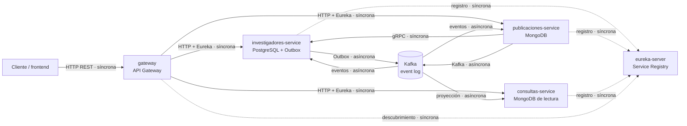

# Arquitectura de RICA

## Alcance y supuestos

Este documento aplica el taller de arquitectura híbrida al repositorio RICA.
Describe la arquitectura que existe en el código y distingue las decisiones
implementadas de las actividades que requieren validación del grupo. Los
escenarios de calidad son objetivos de diseño para este proyecto académico,
no resultados de una prueba de carga formal.

## 1. Contexto y motivadores

RICA permite registrar investigadores y sus publicaciones académicas. El
frontend o cliente consume un API Gateway, mientras los servicios de
investigadores, publicaciones y consultas evolucionan de forma independiente.
La información operacional se mantiene en los servicios de escritura y una
proyección CQRS permite consultas de lectura sin acoplarlas a ese modelo.

### Atributos de calidad priorizados

1. **Integridad y consistencia**: una publicación solo se registra si el
   investigador existe; la eliminación completa se coordina mediante una Saga.
2. **Interoperabilidad**: los contratos gRPC, HTTP y los eventos JSON deben
   permitir que los servicios se integren sin compartir clases de dominio.
3. **Disponibilidad y resiliencia**: la caída temporal de Kafka no debe perder
   eventos; los consumidores deben tolerar duplicados y reintentos.
4. **Modificabilidad**: un cambio en el modelo de lectura no debe obligar a
   modificar los servicios de escritura.
5. **Observabilidad y testabilidad**: cada petición debe poder correlacionarse
   entre servicios y las reglas de dominio deben probarse sin infraestructura.

### Escenarios medibles

- Con 50 solicitudes simultáneas de consulta, el percentil 95 de
  `GET /api/consultas/**` debe ser menor a 500 ms en el entorno de evaluación.
- El 100% de los eventos guardados en la Outbox debe permanecer pendiente y
  publicarse cuando Kafka vuelva a estar disponible.
- Una entrega duplicada del mismo evento no debe crear una segunda publicación
  ni una segunda aplicación de la misma transición.
- Una petición con `X-Correlation-Id` debe mostrar el mismo valor en los logs
  de los participantes de la Saga.

### Restricciones

- Proyecto académico con un equipo y cinco servicios Spring Boot.
- Java 25, Maven Wrapper, Docker Desktop y GitHub Actions.
- PostgreSQL, MongoDB, Kafka y Eureka ya forman parte del entorno.
- No se dispone actualmente de Kubernetes ni de una plataforma de observabilidad
  distribuida dedicada.

## 2. Estilos y patrones por componente

| Componente | Estilo / patrón | Almacén | Comunicación | Atributo que sirve |
|---|---|---|---|---|
| gateway | API Gateway y descubrimiento de servicios | — | HTTP entrante, Eureka | Interoperabilidad y simplicidad del cliente |
| investigadores-service | Microservicio hexagonal | PostgreSQL | REST, gRPC servidor, Kafka mediante Outbox | Integridad, testabilidad y resiliencia |
| publicaciones-service | Microservicio orientado a documentos | MongoDB | REST, gRPC cliente, Kafka | Interoperabilidad y flexibilidad |
| consultas-service | CQRS, modelo de lectura materializado | MongoDB independiente | REST, Kafka consumidor | Modificabilidad y rendimiento |
| eureka-server | Service Registry | Memoria | HTTP de registro y descubrimiento | Disponibilidad operativa |
| Kafka | EDA y log durable | Log de eventos | Publicar/suscribir asíncrono | Desacoplamiento y durabilidad |
| Outbox | Transactional Outbox | Tabla en PostgreSQL | Polling hacia Kafka | Consistencia y resiliencia |
| Saga de eliminación | Coreografía | Estado del agregado y proyección | Eventos asíncronos | Consistencia eventual |

Cada estilo resuelve un problema concreto: gRPC resuelve la validación inmediata
del investigador, Kafka desacopla la propagación de hechos y CQRS separa las
lecturas de las escrituras. No se añade un estilo sin una necesidad observable.

## 3. Fronteras, contratos y diagrama C4

### Conexiones

| Origen | Destino | Tipo | Contrato |
|---|---|---|---|
| Cliente | gateway | Síncrona | HTTP REST `/api/**` |
| publicaciones-service | investigadores-service | Síncrona | gRPC para validar investigador |
| investigadores-service | Kafka | Asíncrona | Outbox y eventos JSON |
| publicaciones-service | Kafka | Asíncrona | Eventos de publicaciones y confirmación de Saga |
| consultas-service | Kafka | Asíncrona | Consumidores de eventos de dominio |
| servicios | eureka-server | Síncrona | Registro/descubrimiento HTTP |

### Eventos publicados

| Evento | Productor | Consumidores | Datos principales |
|---|---|---|---|
| `investigadores.registrados` | investigadores-service | publicaciones-service, consultas-service | id, nombre, correo |
| `investigadores.en-eliminacion` | investigadores-service | publicaciones-service, consultas-service | correo, id de correlación |
| `publicaciones.registradas` | publicaciones-service | consultas-service | id, título, tipo, año, correo |
| `publicaciones.marcadas-huerfanas` | publicaciones-service | investigadores-service | correo, cantidad, correlación |
| `investigadores.eliminados` | investigadores-service | consultas-service | correo, id de correlación |

La cadena de validación gRPC tiene un salto síncrono. La eliminación usa eventos
para evitar una transacción distribuida. Los eventos son contratos JSON versionables;
los consumidores deben ignorar campos nuevos y conservar idempotencia.

## 4. Decisiones (ADR)

### ADR-001: separar investigadores, publicaciones y consultas

- Estado: Aceptada
- Contexto: los investigadores, las publicaciones y las consultas tienen
  modelos y ritmos de cambio distintos.
- Decisión: mantener servicios separados, con `consultas-service` como modelo
  de lectura CQRS y referencias entre agregados por identidad.
- Alternativa descartada: un monolito único con una base compartida; simplificaría
  el despliegue, pero acoplaría modelos y ciclos de cambio.
- Consecuencias:
  - Positivas: límites claros, despliegue independiente y lecturas optimizadas.
  - Negativas: más procesos, contratos distribuidos y mayor costo operativo.

### ADR-002: usar gRPC para validar investigadores

- Estado: Aceptada
- Contexto: publicaciones necesita una respuesta inmediata antes de registrar
  una publicación.
- Decisión: `publicaciones-service` consulta a `investigadores-service` mediante
  gRPC y protege la llamada con Circuit Breaker.
- Alternativa descartada: duplicar investigadores en MongoDB; evitaría la llamada,
  pero introduciría sincronización y datos potencialmente obsoletos.
- Consecuencias:
  - Positivas: contrato tipado y validación síncrona.
  - Negativas: dependencia temporal entre servicios y configuración adicional.

### ADR-003: usar Outbox, Kafka y Saga coreografiada

- Estado: Aceptada
- Contexto: los cambios de investigadores deben propagarse sin escritura dual
  ni transacciones distribuidas.
- Decisión: guardar eventos en Outbox con el cambio de negocio, publicarlos en
  Kafka y coordinar la eliminación con eventos idempotentes.
- Alternativa descartada: publicar directamente después de guardar o usar una
  transacción distribuida; ambas opciones aumentan la inconsistencia o el
  acoplamiento operativo.
- Consecuencias:
  - Positivas: durabilidad, desacoplamiento y recuperación ante caída de Kafka.
  - Negativas: consistencia eventual, duplicados, polling y mayor complejidad
    de diagnóstico.

## 5. Fitness functions

1. **Aislamiento de dominio**: ningún paquete de dominio de
   `investigadores-service` debe importar Spring MVC, JPA o Kafka. Se verifica
   con una prueba ArchUnit en cada cambio de CI.
2. **Contratos de integración**: los eventos deben contener los campos requeridos
   por sus consumidores (`correoInstitucional`, identidad y `correlationId`
   cuando el flujo lo exige). Se verifica con pruebas de consumidores y ejemplos
   JSON en CI.
3. **Idempotencia**: procesar dos veces el mismo evento no debe duplicar una
   publicación ni cambiar dos veces una ficha. Se verifica con las pruebas
   unitarias de consumidores antes de cada merge.
4. **Observabilidad de Saga**: una eliminación con un `X-Correlation-Id` debe
   conservar el mismo id en los logs de investigadores y publicaciones. Se
   verifica con una prueba de integración manual antes de una entrega.

## 6. Mesh: ¿lo necesitamos?

### Service mesh: no por ahora

El sistema tiene cinco servicios, un equipo pequeño, no usa Kubernetes y ya
cuenta con Eureka, Circuit Breaker, correlación de logs y Gateway. Un mesh
duplicaría esas capacidades y añadiría sidecars, certificados, configuración
operativa y una plataforma de despliegue que el proyecto no necesita.

### Data mesh: no por ahora

Hay dos dominios de escritura y una proyección de lectura administrados por el
mismo equipo; no existen múltiples equipos autónomos ni una organización grande
de datos. En su lugar se mantienen bases por servicio, contratos de eventos y
responsabilidad clara sobre cada modelo.

## 7. Riesgos y deuda conocida

- **Kafka y bases locales**: el despliegue actual depende de Docker Desktop y
  configuración local; en producción necesitaría alta disponibilidad y secretos.
- **Consistencia eventual**: una Saga puede quedar en `EN_ELIMINACION`; se debe
  añadir alerta, reintento controlado y compensación si el flujo crece.
- **Evolución de eventos**: aún no hay un registro formal de esquemas ni
  compatibilidad automatizada entre productores y consumidores.
- **Observabilidad parcial**: hay correlation id y Actuator, pero faltan trazas
  distribuidas, dashboards y alertas persistentes.
- **CI sin infraestructura de integración**: el workflow excluye pruebas de
  arranque completo; se debe añadir Testcontainers cuando la entrega lo requiera.

## 8. Revisión cruzada pendiente

Esta parte requiere una persona o grupo externo. Usar esta lista y registrar
hallazgos antes de la entrega:

- [ ] Atributos ordenados y escenarios medibles.
- [ ] Cada componente tiene un atributo y una justificación.
- [ ] Cada flecha del diagrama tiene tecnología y tipo.
- [ ] No hay una cadena síncrona larga sin explicación.
- [ ] Cada ADR incluye alternativa y costo negativo.
- [ ] Mesh justificado con cantidad de servicios y equipos.
- [ ] Hay al menos dos fitness functions verificables.
- [ ] Hay riesgos y deuda reconocidos.
- [ ] Una persona externa entiende el documento en diez minutos.
